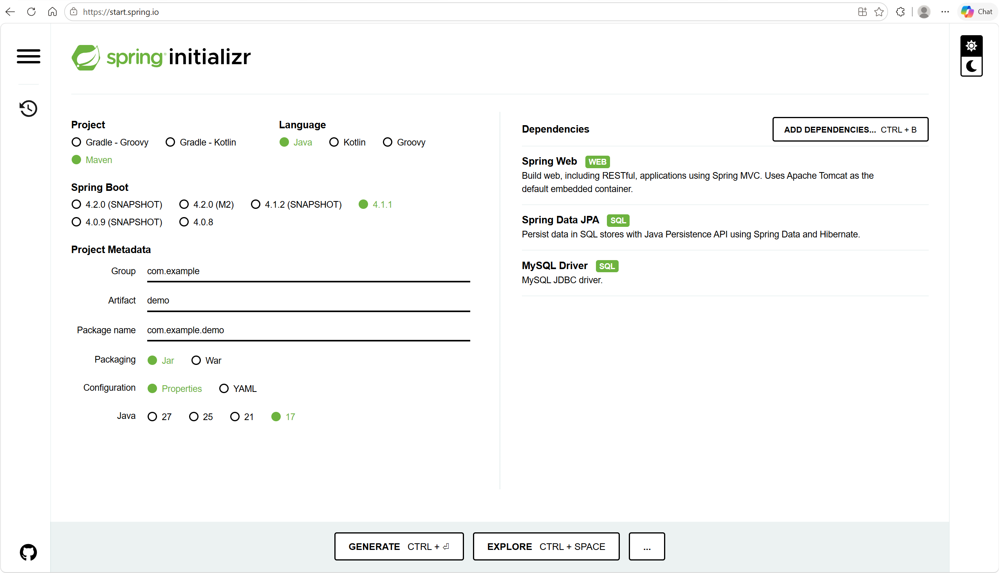
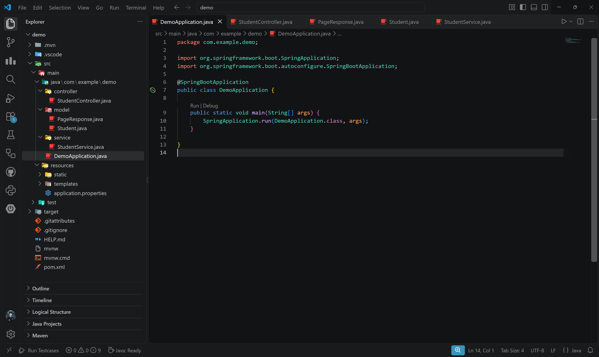
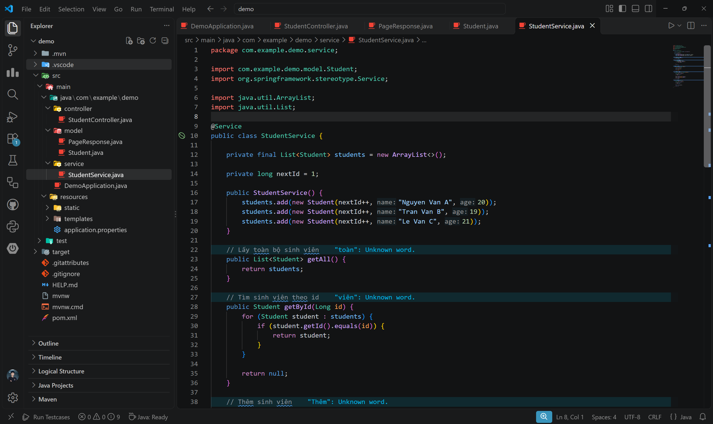
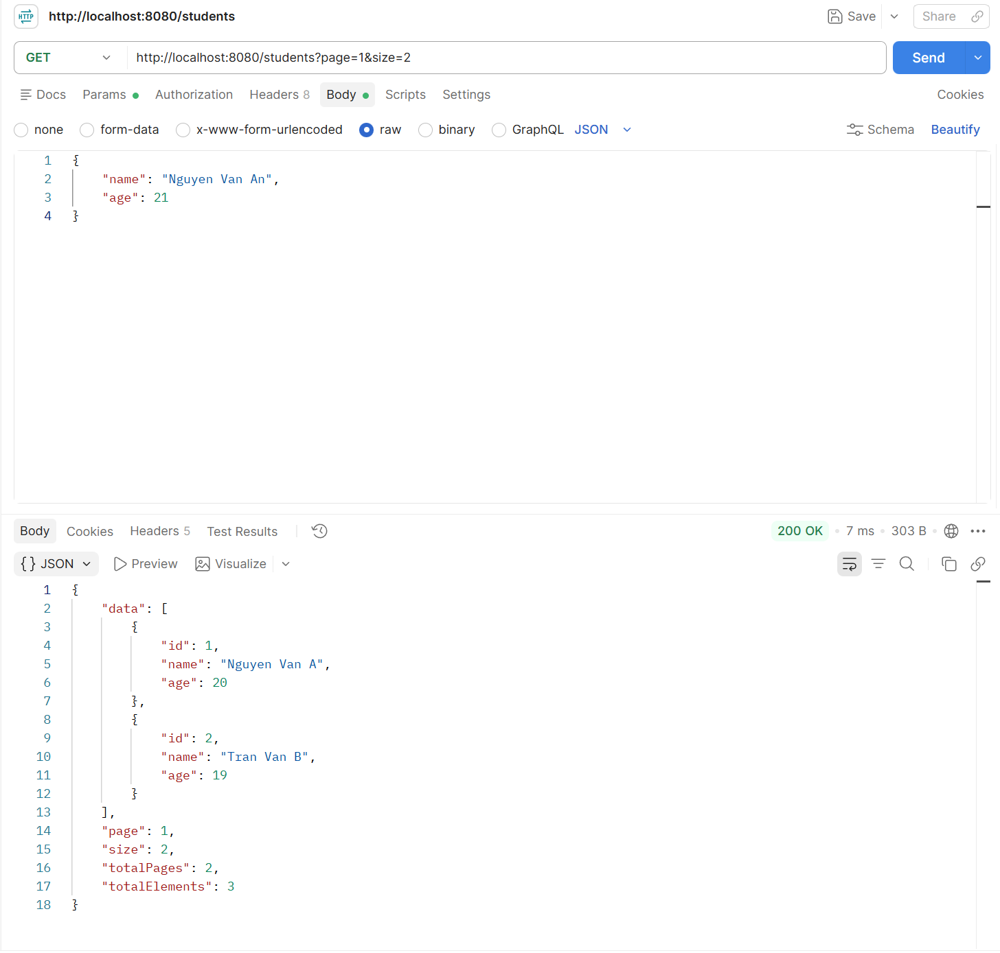
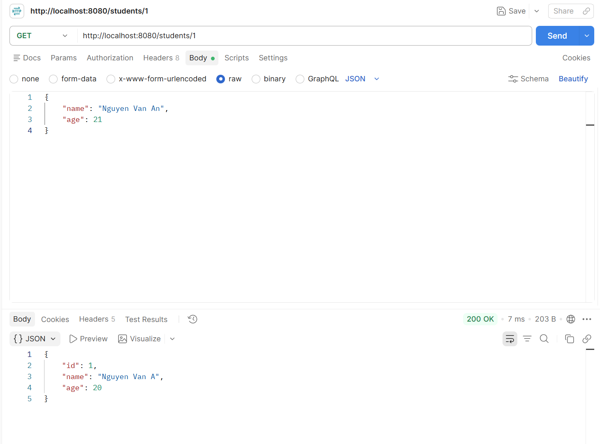
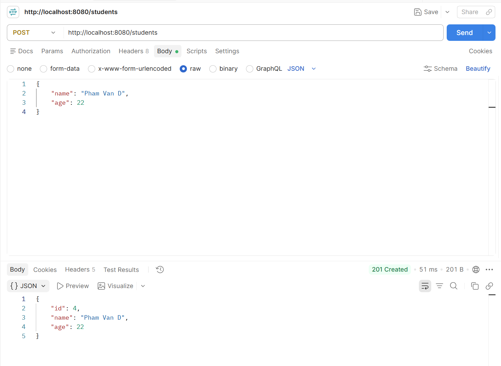
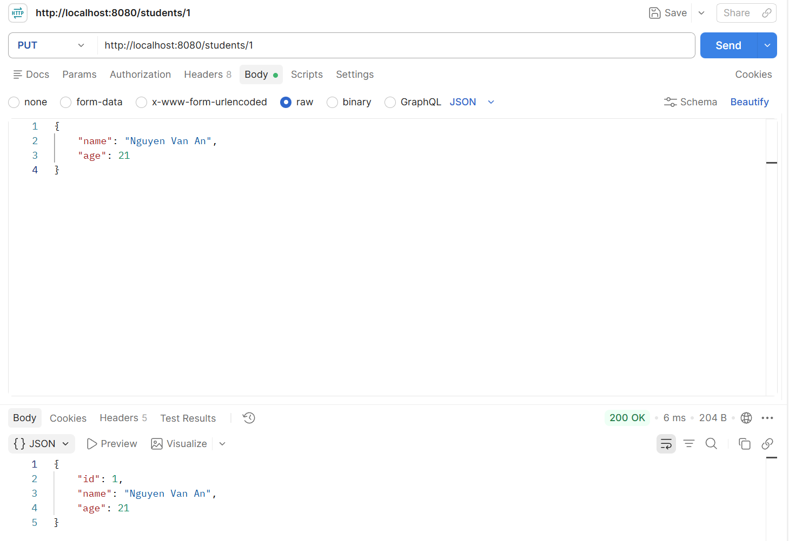
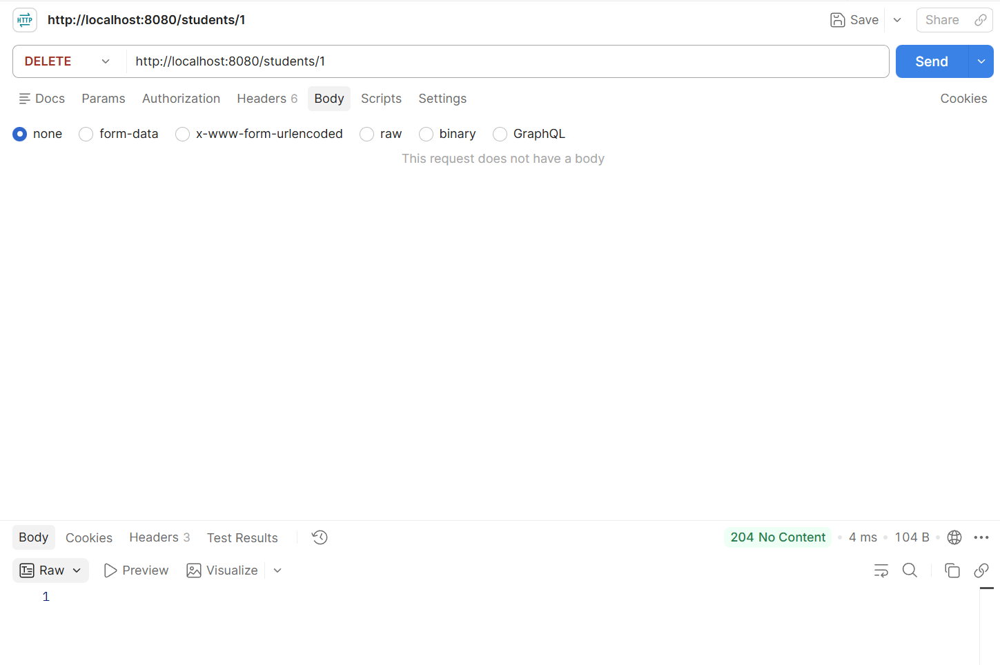

# Tuần 2: Framework, RESTful API và ORM

---

## Phần 1: Framework & Xây dựng RESTful API

### 1. Lựa chọn Framework

Framework được em lựa chọn là **Spring Boot**.

Spring Boot là một framework được xây dựng dựa trên Spring Framework, giúp đơn giản hóa quá trình phát triển ứng dụng Java, đặc biệt là các ứng dụng Backend và RESTful API.

Một số ưu điểm của Spring Boot:

- Giảm lượng cấu hình cần thiết so với Spring Framework truyền thống.
- Có thể nhanh chóng tạo một ứng dụng Web.
- Tích hợp sẵn Web Server như Tomcat.
- Hỗ trợ RESTful API tốt.
- Dễ dàng kết nối với cơ sở dữ liệu.
- Hỗ trợ JPA và Hibernate.
- Có hệ sinh thái thư viện lớn.
- Phù hợp cho việc xây dựng các hệ thống Backend và Microservices.

### 2. Tạo Project & Cấu trúc

#### 2.1. Khởi tạo Project

Project được khởi tạo bằng **Spring Initializr**.

Cấu hình project với các thông tin cơ bản như:




#### 2.2. Cấu trúc Project Spring Boot

Một project Spring Boot thường có cấu trúc như sau:

```text
src
├── main
│   ├── java
│   │   └── com.example.demo
│   │       ├── controller
│   │       ├── model
│   │       ├── repository
│   │       ├── service
│   │       └── DemoApplication.java
│   │
│   └── resources
│       └── application.properties
│
└── test
```

Mỗi thư mục có một nhiệm vụ riêng.

##### 2.2.1. Controller

Thư mục `controller` chứa các class chịu trách nhiệm tiếp nhận HTTP Request từ Client và trả về HTTP Response.

**Ví dụ:** `controller/StudentController.java`

**Một Controller có thể được khai báo như sau:**

```java
@RestController
@RequestMapping("/students")
public class StudentController {

}
```

**Trong đó:**

- `@RestController`: khai báo class là REST Controller.
- `@RequestMapping("/students")`: xác định URL chung cho các API trong Controller.

**Controller** thường xử lý các request như:

```text
GET /students
GET /students/1
POST /students
PUT /students/1
DELETE /students/1
```

##### 2.2.2. Model

Thư mục `model` chứa các class biểu diễn dữ liệu của hệ thống.

**Ví dụ đối tượng `Student`:**

```java
public class Student {
    private Long id;
    private String name;
    private Integer age;
}
```

Mỗi đối tượng Student có thể gồm các thuộc tính như:

- id
- name
- age

Khi tích hợp với cơ sở dữ liệu, class này có thể trở thành một Entity.

**Ví dụ:**

```java
@Entity
@Table(name = "students")
public class Student {

    @Id
    @GeneratedValue(strategy = GenerationType.IDENTITY)
    private Long id;

    private String name;

    private Integer age;
}
```

##### 2.2.3. Routes

Trong **Spring Boot** không có thư mục `routes` riêng. Các route của REST API được định nghĩa trực tiếp trong các lớp **Controller** thông qua các annotation như: 
- `@RequestMapping`
- `@GetMapping` 
- `@PostMapping `
- `@PutMapping`
- `@DeleteMapping`

##### 2.2.4. Service

Thư mục `service` chứa phần xử lý nghiệp vụ của chương trình.

**Ví dụ:** `service/StudentService.java`

**Service có nhiệm vụ:**

- Lấy danh sách sinh viên.
- Tìm sinh viên theo ID.
- Thêm sinh viên.
- Cập nhật sinh viên.
- Xóa sinh viên.

Việc tách **Service** khỏi **Controller** giúp chương trình dễ quản lý và bảo trì hơn.

**Controller** chỉ xử lý **Request/Response**, còn **Service** chịu trách nhiệm xử lý logic.

Luồng xử lý thường là:

```text
Client
   ↓
Controller
   ↓
Service
   ↓
Repository
   ↓
Database
```

##### 2.2.5. Migrations

**Spring Boot** không tạo sẵn thư mục `migrations`. Trong bài thực hành cơ bản, cấu trúc cơ sở dữ liệu có thể được quản lý thông qua Hibernate/JPA. Với các dự án thực tế cần kiểm soát phiên bản cơ sở dữ liệu, có thể sử dụng các công cụ như Flyway hoặc Liquibase.

#### 2.3. File cấu hình application.properties

**File:** `src/main/resources/application.properties` được sử dụng để lưu các cấu hình của ứng dụng.

**Ví dụ cấu hình server:**

```properties
spring.application.name=student-api

server.port=8080
```

**Nếu sử dụng MySQL có thể cấu hình:**

```properties
spring.datasource.url=jdbc:mysql://localhost:3306/student_db
spring.datasource.username=root
spring.datasource.password=123456

spring.jpa.hibernate.ddl-auto=update
spring.jpa.show-sql=true
```

**Trong đó:**

- `spring.datasource.url`: Xác định địa chỉ của Database.
- `spring.datasource.username`: Tên tài khoản đăng nhập Database.
- `spring.datasource.password`: Mật khẩu của Database.
- `spring.jpa.hibernate.ddl-auto`: Quy định cách Hibernate xử lý cấu trúc bảng trong cơ sở dữ liệu.
- `spring.jpa.show-sql=true`: Cho phép hiển thị SQL do Hibernate thực thi trên Console.

### 3. Xây dựng RESTful API

**RESTful API** là một kiểu API được thiết kế theo kiến trúc **REST** (Representational State Transfer), giúp client (web, mobile...) và server giao tiếp với nhau thông qua giao thức **HTTP** một cách rõ ràng, logic và hiệu quả.

Client gửi HTTP Request tới Server, Server xử lý và trả về HTTP Response.

**Một API quản lý Student có thể sử dụng URL:** `/students`.

**Các thao tác CRUD được ánh xạ với HTTP Method như sau:**

| Chức năng | HTTP Method | API |
|---|---|---|
| Lấy danh sách | GET | `/students` |
| Lấy theo ID | GET | `/students/{id}` |
| Thêm mới | POST | `/students` |
| Cập nhật | PUT | `/students/{id}` |
| Xóa | DELETE | `/students/{id}` |

#### 3.1. HTTP Methods

##### 3.1.1. GET

**GET** được sử dụng để lấy dữ liệu từ Server.

**Ví dụ:**

```java
@GetMapping
public List<Student> getAllStudents() {
    return students;
}
```

**Request:** `GET /students` server trả về danh sách Student dưới dạng JSON.

##### 3.1.2. POST

**POST** được sử dụng để tạo một dữ liệu mới.

**Ví dụ:**

```java
@PostMapping
public ResponseEntity<Student> createStudent(@RequestBody Student student) {

    Student result = studentService.createStudent(student);

    return ResponseEntity.status(HttpStatus.CREATED).body(result);
}
```

**Client gửi JSON:**

```json
{
    "name": "Nguyen Van A",
    "age": 20
}
```

**Annotation:** `@RequestBody` giúp Spring Boot tự động chuyển JSON từ HTTP Request thành object Java.

##### 3.1.3. PUT

**PUT** thường được sử dụng để cập nhật một đối tượng.

**Ví dụ:**

```text
PUT /students/1
```

**Request Body:**

```json
{
    "name": "Nguyen Van B",
    "age": 21
}
```

Server tìm Student có ID bằng `1` và cập nhật thông tin tương ứng.

##### 3.1.4. DELETE

**DELETE** được sử dụng để xóa dữ liệu.

**Ví dụ:**

```text
DELETE /students/1
```

Server sẽ xóa Student có ID bằng `1`.

#### 3.2. Mapping URL tới hàm xử lý

Spring Boot sử dụng các annotation để ánh xạ HTTP Request tới các method.

**Ví dụ:**

`@GetMapping` tương ứng với: `GET /students`

**Trong khi:**

`@GetMapping("/{id}")` tương ứng với: `GET /students/{id}`

**Ngoài ra còn có:**

```java
@PostMapping
@PutMapping
@PatchMapping
@DeleteMapping
```

#### 3.3. Xử lý Request

Có ba cách phổ biến để truyền dữ liệu từ Client tới REST API.

##### 3.3.1. Path Variable

**Path Variable** truyền dữ liệu trực tiếp trong URL.

**Ví dụ:**

```text
GET /students/10
```

**Controller:**

```java
@GetMapping("/{id}")
public Student getStudent(@PathVariable Long id) {
    return studentService.getStudentById(id);
}
```

**Trong trường hợp trên:**

```text
id = 10
```

##### 3.3.2. Query Param

**Query Param** thường được sử dụng để:

- Lọc dữ liệu
- Tìm kiếm
- Sắp xếp
- Phân trang

**Ví dụ:**

```text
GET /students?age=20
```

**Controller:**

```java
@GetMapping
public List<Student> getStudents(@RequestParam Integer age) {
    return studentService.getStudentsByAge(age);
}
```

**Một ví dụ khác là phân trang:**

```text
GET /students?page=0&size=10
```

##### 3.3.3. Request Body

**Request Body** được dùng khi Client cần gửi một object hoặc dữ liệu lớn tới Server.

**Ví dụ:**

```java
@PostMapping
public Student createStudent(@RequestBody Student student) {
    return studentService.createStudent(student);
}
```

**JSON gửi từ Postman:**

```json
{
    "name": "Tran Van B",
    "age": 19
}
```

Spring Boot sẽ tự động ánh xạ JSON thành object `Student`.

---

#### 3.4. Xử lý Response

**REST API** thường trả dữ liệu về dưới dạng **JSON**.

**Ví dụ:**

```json
{
    "id": 1,
    "name": "Nguyen Van A",
    "age": 20
}
```

Ngoài dữ liệu, Server cũng cần trả về HTTP Status Code phù hợp.

**Một số Status Code thường sử dụng:**

| Status | Ý nghĩa |
|---|---|
| 200 OK | Request thành công |
| 201 Created | Tạo dữ liệu thành công |
| 400 Bad Request | Request không hợp lệ |
| 404 Not Found | Không tìm thấy dữ liệu |
| 500 Internal Server Error | Lỗi phía Server |

Spring Boot có thể sử dụng `ResponseEntity` để điều khiển cả dữ liệu và Status Code.

**Ví dụ:**

```java
return ResponseEntity.ok(student);
```

**Hoặc:**

```java
return ResponseEntity.status(HttpStatus.CREATED).body(student);
```

---

#### 3.5. Error Handling

Trong **REST API** cần có một cấu trúc xử lý lỗi thống nhất.

**Ví dụ:**

```json
{
    "code": 404,
    "message": "Student not found",
    "details": "Student with id 10 does not exist"
}
```

**Lỗi HTTP thường được chia thành hai nhóm chính:**

**1. Client Error**

**Các lỗi thuộc nhóm:** `4xx` thường xảy ra do Request phía Client.

**Ví dụ:**

```text
400 Bad Request
401 Unauthorized
403 Forbidden
404 Not Found
```

**2. Server Error**

**Các lỗi:** `5xx` xảy ra trong quá trình Server xử lý Request.

**Ví dụ:**

```text
500 Internal Server Error
```

**Trong Spring Boot có thể sử dụng:** `@RestControllerAdvice` **kết hợp với:** `
@ExceptionHandler` để xử lý Exception dùng chung cho toàn bộ chương trình.

### 4. Pagination

Khi số lượng dữ liệu lớn, không nên trả về toàn bộ dữ liệu trong một Request.

Phân trang giúp chia dữ liệu thành các trang nhỏ.

**Ví dụ:**

```text
GET /students?page=0&size=10
```

**Trong đó:**

- `page`: số trang.
- `size`: số phần tử trên mỗi trang.

**Response có thể có dạng:**

```json
{
    "data": [],
    "page": 0,
    "size": 10,
    "totalPages": 5,
    "totalElements": 45
}
```

**Khi sử dụng Spring Data JPA có thể sử dụng:**

```java
Pageable pageable = PageRequest.of(page, size);
```

**Sau đó:**

```java
Page<Student> result = studentRepository.findAll(pageable);
```

Việc phân trang giúp giảm lượng dữ liệu truyền qua mạng và cải thiện hiệu năng của hệ thống.

### 5. Thực hành

#### 5.1. Xây dựng API CRUD cho 1 đối tượng (Student, Book, Product)




#### 5.2. Dữ liệu lưu tạm trong List/Array (chưa cần DB)



#### 5.3. `GET /students` (có phân trang)



#### 5.4. `GET /students/{id}`



#### 5.5. `POST /students`



#### 5.6. `PUT /students/{id}`



#### 5.7. `DELETE /students/{id}`



---

## Phần 2: Tích hợp Database (ORM)

### 1. ORM là gì? Lợi ích?

**ORM** là viết tắt của **Object-Relational Mapping**, là kỹ thuật ánh xạ giữa đối tượng trong chương trình và dữ liệu trong cơ sở dữ liệu quan hệ.

Trong Java, dữ liệu thường được biểu diễn bằng các object. 

**Ví dụ:**

```java
Student student = new Student();

student.setId(1L);
student.setName("Nguyen Van A");
student.setAge(20);
```

Trong cơ sở dữ liệu quan hệ, dữ liệu lại được lưu dưới dạng bảng:

**Students**
| id | name | age |
| :--: | :--: | :--: | 
|1| Nguyen Van A | 20 |

**ORM đóng vai trò trung gian để ánh xạ giữa:** Java Object và Database. Nhờ ORM, lập trình viên có thể thao tác với object Java thay vì phải tự viết SQL cho mọi thao tác.

Ví dụ, nếu không sử dụng ORM, để lấy Student có id = 1, có thể phải viết:

```sql
SELECT *
FROM students
WHERE id = 1;
```

Khi sử dụng Spring Data JPA, có thể viết:

```java
studentRepository.findById(1L);
```

Framework sẽ chịu trách nhiệm tạo câu SQL thích hợp, gửi câu truy vấn đến database, nhận kết quả và chuyển dữ liệu từ database thành object `Student`.

#### 1.1. Tại sao cần ORM?

Nếu dữ liệu chỉ lưu trong bộ nhớ chương trình như `ArrayList`, thì khi chương trình tắt dữ liệu sẽ mất hết.

Vì vậy, khi dữ liệu được ánh xạ và lưu trữ trong database, nó sẽ được lưu lâu dài trong hệ quản trị cơ sở dữ liệu. Và khi sever khởi động lại, thì dữ liệu vẫn còn đó.

#### 1.2. Lợi ích của ORM

**ORM** mang lại nhiều lợi ích trong quá trình phát triển ứng dụng Backend.

##### 1.2.1. Giảm lượng SQL phải viết

Nếu không dùng ORM, lập trình viên thường phải tự viết các câu SQL như:

```sql
INSERT INTO students(name, age)
VALUES ('Nguyen Van A', 20);
```

```sql
SELECT *
FROM students;
```

```sql
UPDATE students
SET name = 'Nguyen Van B'
WHERE id = 1;
```

```sql
DELETE FROM students
WHERE id = 1;
```

Với ORM, các thao tác tương ứng có thể được thực hiện bằng Java:

```java
repository.save(student);
```

```java
repository.findAll();
```

```java
repository.save(student);
```

```java
repository.deleteById(id);
```

Điều này giúp code gần với mô hình hướng đối tượng hơn.

##### 1.2.2. Ánh xạ tự động giữa object và bảng

ORM tự động chuyển: Object `Students` thành dữ liệu trong Table `Students` và ngược lại.

##### 1.2.3. Giảm code lặp lại

Các thao tác **CRUD** được **ORM** hỗ trợ sẵn như:

- Create
- Read
- Update
- Delete

Lập trình viên không cần viết lại các hàm kết nối database và xử lý SQL cho từng bảng.

##### 1.2.4. Dễ bảo trì

Khi cấu trúc chương trình được chia thành:

```text
Controller
    ↓
Service
    ↓
Repository
    ↓
   ORM
    ↓
Database
```
Khi này mỗi tầng có một nhiệm vụ riêng. Điều này giúp chương trình dễ đọc và dễ bảo trì hơn.

##### 1.2.5. Hỗ trợ quan hệ giữa các bảng

Database thường có các quan hệ như:

- Quan hệ **1 - 1**
- Quan hệ **1 - N**
- Quan hệ **N - 1**
- Quan hệ **N - N**

ORM cho phép biểu diễn những quan hệ này trực tiếp bằng các object Java.

### 2. Sử dụng ORM theo Framework

Trong Spring Boot, các thành phần thường được sử dụng là: JPA + Hibernate, Spring Data JPA, Entity mapping, Repository.

Các thành phần này liên quan với nhau nhưng không hoàn toàn giống nhau.

#### 2.1 JPA

**JPA (Java Persistence API)** là một đặc tả tiêu chuẩn của Java dành cho việc quản lý dữ liệu quan hệ bằng object.

**JPA** định nghĩa cách:

- Java Class ↔ Database Table
- Java Object ↔ Database Row
- Java Field ↔ Database Column

**JPA** cung cấp các annotation phổ biến như:

```java
@Entity
@Table
@Id
@GeneratedValue
@Column
@OneToMany
@ManyToOne
```

**Tuy nhiên, cần lưu ý:** JPA là một specification, không phải bản thân hệ thống thực thi database. Có thể hiểu JPA giống như một bộ quy tắc quy định ORM trong Java nên hoạt động như thế nào.

#### 2.2. Hibernate

**Hibernate** là một ORM framework dành cho Java và là một trong những implementation phổ biến nhất của JPA.

**Nếu JPA quy định:** Một Entity phải được ánh xạ như thế nào? 

Thì **Hibernate** là công cụ thực hiện việc đó trên thực tế.

**Có thể hiểu đơn giản:**

- **JPA** = quy tắc / tiêu chuẩn
- **Hibernate** = công cụ thực hiện quy tắc đó

#### 2.3. Spring Data JPA

**Spring Data JPA** là một phần của hệ sinh thái Spring giúp lập trình viên sử dụng JPA thuận tiện hơn.

Nếu chỉ sử dụng **JPA/Hibernate** trực tiếp, lập trình viên có thể phải viết khá nhiều code cho việc truy vấn dữ liệu.

**Spring Data JPA** cho phép tạo một Repository:

```java
public interface StudentRepository
        extends JpaRepository<Student, Long> {
}
```

Ngay lập tức **Repository** này đã có sẵn nhiều method:

```java
save()
findAll()
findById()
deleteById()
count()
existsById()
```

**Vì vậy có thể hiểu:** Spring Data JPA giúp sử dụng JPA/Hibernate dễ dàng hơn.

#### 2.4. Entity Mapping

##### 2.4.1 Entity là gì?

Trong ORM, **Entity** là một Java class được ánh xạ với một bảng trong database.

Ví dụ class:

```java
public class Student {
    private Long id;
    private String name;
    private Integer age;
}
```

Khi sử dụng ORM có thể trở thành:

```java
@Entity
@Table(name = "students")
public class Student {
    @Id
    @GeneratedValue(strategy = GenerationType.IDENTITY)
    private Long id;

    private String name;

    private Integer age;
}
```

Khi này Class `Student` được ánh xạ với bảng `students`.

##### 2.4.2. @Entity

**Annotation** `@Entity` đánh dấu class là một Entity được JPA quản lý.

Ví dụ:

```java
@Entity
public class Student {
}
```

Khi Spring Boot khởi động, Hibernate sẽ nhận biết `Student` là một **Entity** cần được ánh xạ với database.

##### 2.4.3. @Table

Annotation `@Table(name = "students")` dùng để chỉ định tên bảng trong database.

Nếu không sử dụng `@Table`, JPA có thể sử dụng tên class làm cơ sở xác định tên bảng.

#### 2.5. Repository

**Repository** là tầng chịu trách nhiệm giao tiếp với database.

Ở phần trước, kiến trúc của project là:

```text
Controller
    ↓
Service
    ↓
ArrayList
```

Sau khi tích hợp database, kiến trúc trở thành:

```text
Controller
    ↓
Service
    ↓
Repository
    ↓
Database
```

##### 2.5.1. JpaRepository

Một **Repository** có thể khai báo là:

```java
public interface StudentRepository
        extends JpaRepository<Student, Long> {
}
```

Trong đó:

- `Student` là Entity mà **Repository** quản lý.
- `Long` là là kiểu dữ liệu của **Primary Key**.

##### 2.5.2. CRUD có sẵn trong Repository

`JpaRepository` đã cung cấp các method như:

```java
findAll()
findById()
save()
deleteById()
existsById()
count()
```

### 3. Thực hành

#### 3.1. Thay thế CRUD in-memory bằng ORM kết nối DB thật

Ở phần trước, dữ liệu được lưu:

```java
private final List<Student> students = new ArrayList<>();
```

Các thao tác được thực hiện thủ công.

Ví dụ tìm Student:

```java
for (Student student : students) {
    if (student.getId().equals(id)) {
        return student;
    }
}
```

Sau khi sử dụng Spring Data JPA, có thể thay bằng:

```java
studentRepository.findById(id);
```

Tương tự, thêm dữ liệu từ:

```java
students.add(student);
```

Thành:

```java
studentRepository.save(student);
```

Như vậy, `ArrayList` được thay bằng `Database` và `StudentRepository` là thành phần giúp Service giao tiếp với database.

#### 3.2. Pagination query từ DB thật (LIMIT/OFFSET hoặc cursor)

Ở phần ArrayList, phân trang bằng:

```java
int start = (page - 1) * size;
int end = Math.min(start + size, totalElements);

students.subList(start, end);
```

Cách này chỉ phù hợp khi dữ liệu đã nằm trong bộ nhớ.

**Nếu database có:** 1.000.000 bản ghi thì việc lấy toàn bộ về java sau mới lấy 10 bản ghi là rất lãng phí.

Do đó, cách làm đúng là Database chỉ trả đúng số bản ghi cần cho trang hiện tại.

##### 3.2.1. LIMIT và OFFSET

SQL hỗ trợ: `LIMIT` và `OFFSET`

Ví dụ: 

```sql
SELECT *
FROM students
LIMIT 10
OFFSET 0;
```

**Nghĩa là:** Lấy 10 student bắt đầu từ vị trí 0

##### 3.2.2. Pagination trong Spring Data JPA

**Spring Data JPA** cung cấp: `Pageable` và `PageRequest`.

Ví dụ:

```java
Pageable pageable = PageRequest.of(page, size);

Page<Student> result = studentRepository.findAll(pageable);
```

**Spring Data JPA** sẽ tự tạo query phân trang thích hợp.

`Page<Student> result` chứa không chỉ dữ liệu mà còn chứa thông tin như:

- content
- totalElements
- totalPages
- number
- size

**Ví dụ:**

- `result.getContent()`: lấy dữ liệu của trang hiện tại.
- `result.getTotalElements()`: lấy tổng số Student.
- `result.getTotalPages()`: lấy tổng số trang.

##### 3.2.3. Lưu ý về số trang trong Spring Data JPA

`PageRequest` sử dụng page index bắt đầu từ: 0

Tức là `page = 0` là trang đầu tiên.

Nếu API muốn client dùng `?page=1&size=10` với trang đầu tiên là 1, có thể chuyển thành `PageRequest.of(page - 1, size)`.

##### 3.2.3. Cursor Pagination

Ngoài `LIMIT/OFFSET`, còn có **Cursor Pagination**.

Thay vì yêu cầu `page = 10` client có thể gửi ID của bản ghi cuối cùng đã nhận.

**Ví dụ:** `GET /students?afterId=100&size=10`

**Có thể hiểu:** Lấy 10 Student tiếp theo sau Student có ID 100.

**Query tương đương có thể là:**

```sql
SELECT *
FROM students
WHERE id > 100
ORDER BY id
LIMIT 10;
```

**Cursor Pagination** thường hiệu quả hơn với dữ liệu rất lớn hoặc dữ liệu thay đổi liên tục.

#### 3.3. Relationship giữa các entity (OneToMany, ManyToOne)

Database thực tế thường không chỉ có một bảng.

Ví dụ hệ thống có: `departments` và `students`

Đây là quan hệ: 

- **One To Many** từ `Department` đến `Student`.
- **Many To One** từ `Student` đến `Department`.

##### 3.3.1. ManyToOne

Giả sử mỗi Student thuộc một Department.

Trong `Student`:

```java
@ManyToOne
@JoinColumn(name = "department_id")
private Department department;
```

Database có thể chứa:

**students**
| id | name | department_id |
| :--: | :--: | :--: |

**Trong đó:** `department_id` là Foreign Key.

##### 3.3.2. OneToMany

Trong `Department` có thể viết:

```java
@OneToMany(mappedBy = "department")
private List<Student> students;
```

**Trong đó:** `mappedBy = "department"` nói với JPA: Đừng tạo thêm một quan hệ mới ở đây. Quan hệ này đã được quản lý bởi field `department` trong class `Student`.

**Nói cách khác** `Department.students` không tự giữ khóa ngoại. Khóa ngoại nằm ở `Student.department`