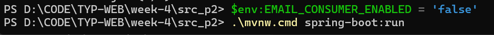
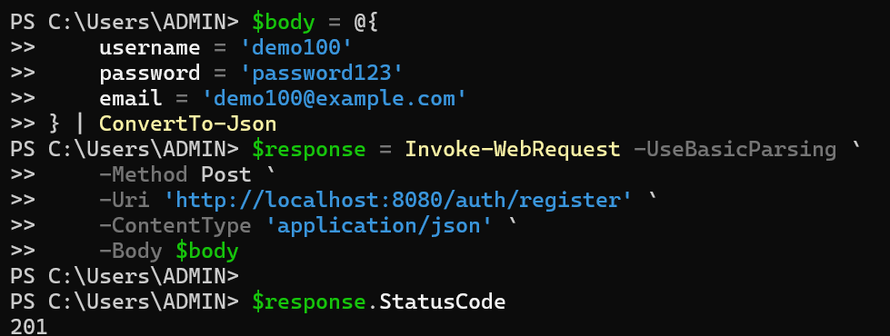
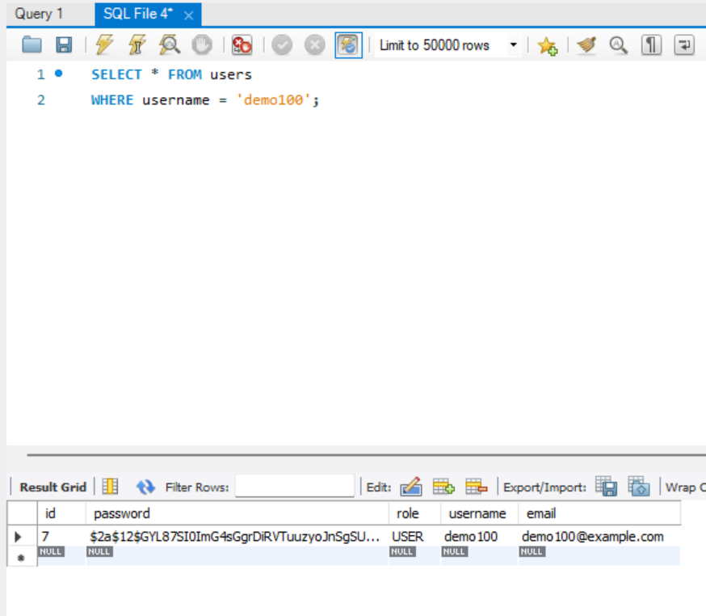
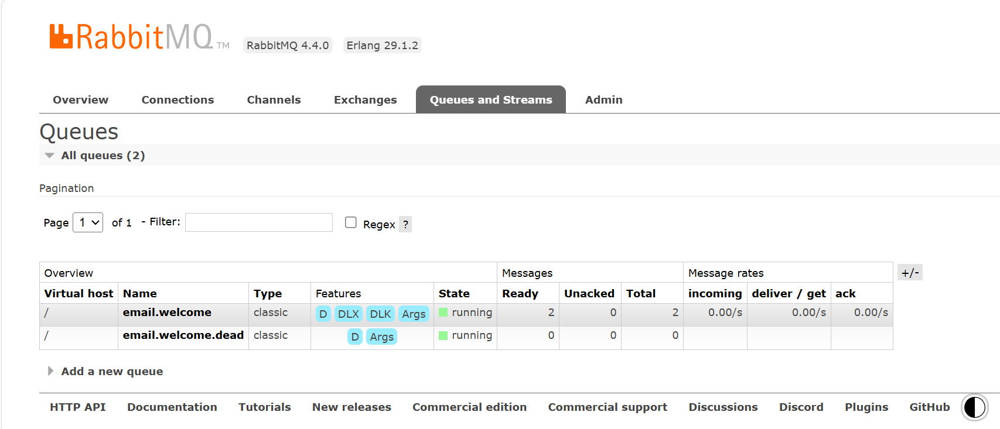
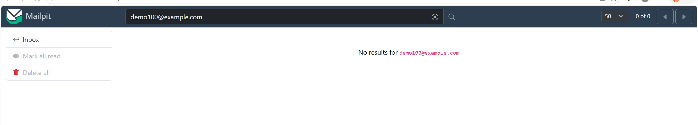
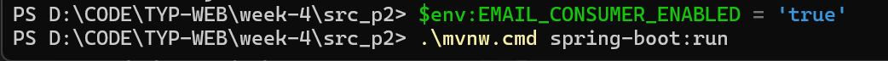
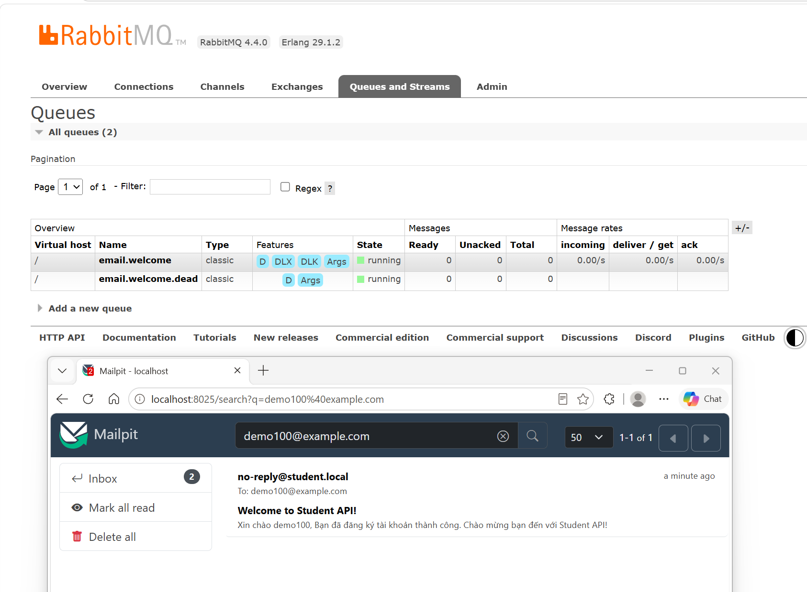

# Tuần 4: Message Queue

---

## 1. Tìm hiểu Message Queue

### 1.1. Message Queue là gì?

**Message Queue (MQ)** là cơ chế cho phép các thành phần trong hệ thống giao tiếp với nhau thông qua một hàng đợi message.

Thay vì Service A gọi trực tiếp Service B và phải chờ B xử lý xong, Service A có thể gửi một **message** vào **Queue**. Sau đó Service B hoặc một service khác sẽ lấy **message** từ **Queue** và xử lý.

**Mô hình cơ bản:** `Producer → Message Queue → Consumer`

*Trong đó:*

- Producer: bên gửi message.
- Queue: nơi lưu message tạm thời.
- Consumer: bên nhận và xử lý message.

### 1.2. Tại sao cần Message Queue? 

**Bài toán:** user đặt hàng xong cần gửi email + cập nhật kho + ghi log - nếu gọi tuần tự thì chậm, 1 cái fail thì cả flow fail

**Giả sử khi user đặt hàng, hệ thống cần:**

1. Tạo đơn hàng.
2. Cập nhật kho.
3. Gửi email.
4. Ghi log.

#### 1.2.1. Xử lý tuần tự

```text
User
 ↓
Tạo đơn hàng
 ↓
Cập nhật kho
 ↓
Gửi email
 ↓
Ghi log
 ↓
Trả response
```

**1. Vấn đề thứ nhất là chậm**

*Ví dụ:*

```text
Tạo đơn hàng:   100ms
Cập nhật kho:   300ms
Gửi email:     2000ms
Ghi log:        100ms
```

Tổng cộng user phải chờ khoảng: `2500ms = 2.5 giây`

Trong khi việc gửi email hoặc ghi log thực ra không cần user phải chờ.

**2. Vấn đề thứ hai là một service lỗi có thể ảnh hưởng cả flow**

*Ví dụ:*

```text
Tạo Order       OK
Cập nhật kho    OK
Gửi Email       FAIL
```

Nếu các thao tác được liên kết trực tiếp với nhau, lỗi Email Service có thể khiến request đặt hàng bị báo lỗi mặc dù đơn hàng đã được tạo.

#### 1.2.2. Dùng Message Queue

```text
                → Inventory Consumer
               /
Order → Queue → Email Consumer
               \
                → Log Consumer
```

**Order Service** tạo đơn hàng xong chỉ cần gửi một message. Sau đó trả response cho user.

**Các service** phía sau tự xử lý riêng.

**Nếu Email Service đang lỗi** thì message có thể vẫn nằm trong Queue hoặc được retry sau. Việc gửi email lỗi không nhất thiết làm việc tạo Order thất bại.

### 1.3. Sync vs Async communication

#### 1.3.1. Sync - Synchronous communication

**Synchronous communication (giao tiếp đồng bộ)** nghĩa là việc bên gọi phải chờ bên được gọi trả kết quả.

*Ví dụ:*

```text
Service A
   |
   | request
   v
Service B
   |
   | xử lý
   |
   | response
   v
Service A
```

Trong thời gian B xử lý thì A phải chờ.

#### 1.3.2. Async - Asynchronous communication

**Asynchronous communication (giao tiếp bất đồng bộ)**
nghĩa là việc bên gửi không cần chờ bên nhận xử lý xong.

*Ví dụ:*

```text
Order Service
     ↓
ORDER_CONFIRMED
     ↓
Queue
```

**Order Service** gửi xong là có thể tiếp tục.

**Email Service** sẽ xử lý sau.

*Hai service* không cần chạy đồng thời tại đúng một thời điểm.

#### 1.3.3. Điểm khác nhau giữa Sync và Async

| Tiêu chí | Sync | Async |
|:--:|:--:|:--:|
| Có phải đợi? | Có | Không |
| Có kết quả ngay? | Có | Thường không |
| Ví dụ | REST API | RabbitMQ |
| Service phụ thuộc nhau | Nhiều hơn | Ít hơn |
| Xử lý lỗi | Dễ hiểu hơn | Phức tạp hơn |
| Phù hợp | Cần kết quả ngay | Background task |
| Response user | Có thể chậm hơn | Có thể nhanh hơn |

*Ví dụ về Sync:* Order Service cần biết giá sản phẩm. vì không biết giá thì không tính được tiền.

*Ví dụ về Async:* Order Service cần gửi email. Vì Order không cần biết email đã gửi xong chưa để tồn tại.

### 1.4. Khi nào dùng MQ, khi nào gọi trực tiếp?

#### 1.4.1. Khi nào nên dùng MQ?

**Một cách dễ xác định là hỏi:** Nếu công việc này chưa hoàn thành ngay thì có ảnh hưởng đến kết quả hiện tại không?

*Nếu câu trả lời là: Không thì MQ có thể phù hợp.*

*Ví dụ:* Việc gửi Email khi Order đã tạo thành công, thì Email chậm 2 giây cũng không ảnh hưởng đến Order.

#### 1.4.2. Khi nào nên gọi trực tiếp?

Nếu cần câu trả lời ngay để quyết định bước tiếp theo.

*Ví dụ:* Việc kiểm tra sản phẩm khi Order đã tạo thành công. Thì Order phải biết được số lượng tồn kho, giá cả thì mới tính được và trả về reponse.

## 2. Các mô hình Message Queue

Có hai mô hình giao tiếp phổ biến khi làm việc với **Message Queue**:

- Point-to-Point (Queue)
- Publish/Subscribe (Topic)

**Điểm khác nhau quan trọng nhất là:** Một message sẽ được một consumer xử lý hay được nhiều consumer cùng nhận.

### 2.1. Point-to-Point

**Point-to-Point** là mô hình truyền message trong đó Producer gửi message vào một Queue, và mỗi message chỉ được một Consumer xử lý thành công.

Mô hình cơ bản: `Producer → Queue → Consumer`

*Producer* gửi message vào một *Queue*. *Consumer* lấy message từ *Queue* và xử lý.

**Điểm quan trọng là:** Mỗi message trong Queue chỉ được một Consumer xử lý thành công.

*Ví dụ có một hệ thống xử lý đơn hàng:*

```text
Order Service
     ↓
Order Queue
     ↓
Order Worker
```

**Order Service** gửi:

```json
{
  "orderId": 101,
  "action": "PROCESS_ORDER"
}
```

**Worker** lấy message này ra xử lý.

*Sau khi xử lý thành công*, message đó sẽ không được một Worker khác xử lý lại trong trường hợp thông thường.

**Có phải Point-to-Point luôn chỉ có 1 Consumer không?**

*Câu trả lời là:* Không. Vì có thể có nhiều Consumer cùng đọc một Queue:

```text
                  ┌→ Worker 1
Producer → Queue ─┼→ Worker 2
                  └→ Worker 3
```

*Nhưng nếu Queue có message A:* Thì chỉ một trong các Worker nhận Message A để xử lý.

*Nhờ vậy*, ta có thể chia tải giữa nhiều Consumer.

Đây thường được gọi là mô hình Competing Consumers.

### 2.2. Publish/Subscribe

**Publish/Subscribe (Pub/Sub)** là một mô hình truyền message trong đó Publisher gửi message tới một Topic, và tất cả các Subscriber đã đăng ký quan tâm tới Topic đó đều có thể nhận được message.

*Mô hình cơ bản:*

```text
                → Subscriber A
               /
Publisher → Topic → Subscriber B
               \
                → Subscriber C
```

*Trong đó:*

- Publisher: bên phát message hoặc event.
- Topic: nơi phân phối message theo chủ đề.
- Subscriber: các bên đăng ký nhận message từ Topic đó.

**Điểm quan trọng nhất là:** Một message có thể được nhiều Subscriber cùng nhận và xử lý độc lập.

*Ví dụ:*

```text
  Order Service
       ↓
  ORDER_CREATED
       ↓
     Topic
   /   |   \
  /    |    \
Email Stock Analytics
```

*Khi có sự kiện* **ORDER_CREATED** thì:

- Email Service → gửi email
- Inventory Service → cập nhật dữ liệu liên quan
- Analytics Service → thống kê đơn hàng

### 2.3. Khi nào dùng Point-to-Point?

**Dùng Point-to-Point khi:** Một công việc chỉ cần một Worker thực hiện.

*Ví dụ:* Gửi email

Nếu Queue chứa message "Gửi email tới user10" thì chỉ cần một Email Worker gửi email đó.

Nếu 3 Worker đều nhận cùng một message, thì User10 nhận 3 email giống nhau, do đó sẽ sai.

### 2.4. Khi nào dùng Publish/Subscribe?

**Publish/Subscribe phù hợp khi:** Một sự kiện xảy ra và nhiều hệ thống khác nhau đều cần biết về sự kiện đó.

*Ví dụ:* Sau khi Order được xác nhận:

```text
                  → Email Service
                 /
ORDER_CONFIRMED → Notification Service
                 \
                  → Analytics Service
```

Mỗi service đều cần biết Order đã được xác nhận nhưng làm một việc khác nhau.

### 2.5. So sánh

| Tiêu chí | Point-to-Point | Publish/Subscribe |
|:--:|:--:|:--:|
| Đích chính | Queue | Topic / cơ chế publish |
| Một message được xử lý bởi | Một Consumer | Nhiều Subscriber |
| Mục đích | Phân chia công việc | Phát sự kiện |
| Consumer cạnh tranh nhau | Có thể có | Không cạnh tranh vì đều có quyền nhận |
| Scale Worker | Rất phù hợp | Có thể scale từng subscriber riêng |
| Message thường mang nghĩa | Command/Task | Event |

### 2.6. Kết hợp cả hai

Trong thực tế hai mô hình thường được dùng cùng nhau.

*Ví dụ Order Service phát sự kiện:*

```text
                   → Email Service
                  /
Order → Topic ----→ Analytics Service
                  \
                   → Notification Service
```

Nhưng riêng **Email Service** có thể nhận rất nhiều email cần gửi.

Bên trong **Email Service** lại dùng Queue:

```text
 ORDER_CONFIRMED
        ↓
  Email Service
        ↓
   Email Queue
   /    |    \
Worker Worker Worker
  1      2      3
```

- `Order → các Service` dùng **Publish/Subscribe.**
- `Email Queue → Email Workers` dùng **Point-to-Point.**

## 3. Chọn Message Queue: RabbitMQ

### 3.1. RabbitMQ là gì?

**RabbitMQ** là một Message Broker, tức là một hệ thống trung gian có nhiệm vụ:

- Nhận message từ Producer;
- Định tuyến message;
- Lưu message vào Queue;
- Chuyển message tới Consumer để xử lý.

Có thể hiểu **RabbitMQ** đứng giữa các service: `Service A → RabbitMQ → Service B`.

*Ví dụ:*

```text
Order Service
     ↓
ORDER_CONFIRMED
     ↓
RabbitMQ
     ↓
Email Service
```

*Order Service* không cần biết *Email Service* đang chạy thế nào. Nó chỉ cần publish một message.

### 3.2. Kiến trúc cơ bản của RabbitMQ

**Một mô hình đầy đủ trong RabbitMQ là:**

```text
Producer → Exchange → Queue → Consumer
```

*Hay khi có nhiều Queue:*

```text
                    → Queue A → Consumer A
                   /
Producer → Exchange
                   \
                    → Queue B → Consumer B
```

**Điểm rất quan trọng:** Trong RabbitMQ, Producer publish message tới Exchange. Exchange quyết định message sẽ được chuyển tới Queue nào dựa trên các rule định tuyến. Consumer sau đó lấy message từ Queue.

### 3.3. Producer

**Producer** là ứng dụng tạo và gửi message vào RabbitMQ.

*Ví dụ:* Order Service, sau khi xác nhận đơn hàng có thể tạo message:

```json
{
    "event": "ORDER_CONFIRMED",
    "orderId": 101,
    "userId": 15
}
```

Sau đó **Producer** publish message tới RabbitMQ.

**Producer** không xử lý email, notification hay log. Nó chỉ thông báo: `ORDER_CONFIRMED`

**Trong RabbitMQ**, Producer thường gửi message tới Exchange, không gửi thẳng vào Queue theo mô hình đầy đủ.

### 3.4. Exchange

**Exchange** là thành phần nhận message từ Producer và định tuyến message tới Queue phù hợp.

```text
              message
Producer ----------------→ Exchange
                              ↓
                       quyết định đi đâu
                              ↓
                            Queue
```

**RabbitMQ** hỗ trợ bốn loại Exchange phổ biến:

- Direct Exchange
- Fanout Exchange
- Topic Exchange
- Headers Exchange

#### 3.4.1. Routing Key

**Routing Key** là một chuỗi được Producer gửi kèm message để Exchange dùng khi định tuyến.

*Ví dụ Producer gửi:*

```text
Producer
   |
   | Message
   | Routing Key = "order.created"
   v
Exchange
```

**Routing Key** không phải nội dung chính của message.

#### 3.4.2. Binding Key

**Binding Key** là key được cấu hình trên Binding, dùng để so sánh với Routing Key của message.

*Ví dụ:*

```text
Exchange
   |
   | Binding Key = "email"
   v
email.queue
```

Producer gửi: `Routing Key = "email"`

Với Direct Exchange: `Routing Key == Binding Key` thì message được route vào Queue.

#### 3.4.3. Header

**Header** là metadata đi kèm message dưới dạng key-value.

*Ví dụ message có:*

```json
Body:
{
  "orderId": 101
}

Headers:
type = order
priority = high
region = vn
```

**Header** không phải nội dung chính. Nó giống như các thông tin mô tả thêm về message.

```text
type = order
priority = high
format = json
region = vn
```

Consumer cũng có thể đọc các Header này.

#### 3.4.4. Direct Exchange

**Direct Exchange** định tuyến message dựa trên Routing Key khớp chính xác.

*Ví dụ:*

```text
             routing key = "email"
Producer ----→ Direct Exchange ----→ email.queue
```

*Ta có:*

```text
email.queue
binding key = "email"

log.queue
binding key = "log"
```

*Producer gửi:*

- routing key = "email" thì Exchange → email.queue
- routing key = "log" thì Exchange → log.queue

**Direct Exchange** phù hợp khi bạn muốn: Message có loại nào thì gửi chính xác đến Queue tương ứng.

#### 3.4.2. Fanout Exchange

**Fanout Exchange** gửi message đến tất cả Queue đang bind với nó.

*Ví dụ:*

```text
                         → Email Queue
                        /
Producer → Fanout Exchange → Log Queue
                        \
                         → Notification Queue
```

*Producer gửi một message* thì cả `Email Queue, Log Queue, Notification Queue` đều nhận được bản sao message.

Đây chính là cách rất phù hợp để triển khai mô hình: **Publish/Subscribe**

#### 3.4.3. Topic Exchange

**Topic Exchange** cũng sử dụng Routing Key nhưng hỗ trợ matching theo pattern.

*Ví dụ routing key:*

```text
order.created
order.confirmed
order.cancelled

user.created
user.deleted
```

*Một Queue có thể nói:* Tôi muốn tất cả event liên quan đến order.

*Binding:* `order.*` thì nó có thể nhận:

- order.created
- order.confirmed
- order.cancelled

**Topic Exchange** phù hợp khi hệ thống có rất nhiều loại event và Consumer chỉ quan tâm một nhóm nhất định.

**Một số ký hiệu phổ biến:**

```text
*  = đúng một từ
#  = không hoặc nhiều từ
```

*Ví dụ:*

- `order.*` match với `order.created, order.cancelled`
- `order.#` match với `order.created, order.created.vn, order.payment.completed`

#### 3.4.4. Headers Exchange

**Headers Exchange** là loại Exchange định tuyến message dựa trên các cặp key-value nằm trong phần header của message, thay vì dựa vào Routing Key.

*Ví dụ một message có header:*

```text
type = order
priority = high
region = vn
```

Ta có thể tạo Queue chỉ nhận những message có:

```text
type = order
priority = high
```

### 3.5. Queue

**Queue** là nơi lưu message tạm thời cho đến khi Consumer xử lý.

*Ví dụ*

```text
Exchange → email.queue → Email Consumer
```

Nếu Consumer chưa xử lý kịp, message vẫn có thể chờ trong Queue.

### 3.6. Consumer

**Consumer** là thành phần nhận message từ Queue và xử lý message đó.

*Ví dụ:*

```text
email.queue → Email Consumer → Gửi email
```

*Ví dụ message:*

```json
{
  "event": "SEND_EMAIL",
  "email": "example@gmail.com"
}
```

Consumer nhận message rồi thực hiện: sendEmail()

**Sau khi xử lý thành công**, Consumer có thể gửi acknowledgement (ACK) để báo cho RabbitMQ rằng: *Message này đã xử lý xong.*

*Khi đó RabbitMQ có thể xóa message khỏi Queue.*

## 4. Implement — Phát triển từ project tuần 2-3
- Use case:
  - Hoặc: user đăng ký → gửi message → consumer gửi email welcome
- Flow: API nhận request → xử lý logic chính → đẩy message vào queue → trả response cho user ngay (không chờ email gửi xong)

### 4.1. Toàn bộ luồng hoạt động

**Trước đây, đăng ký có luồng:**

```text
Client → Controller → AuthService → lưu user → tạo token → trả response
```

**Sau khi bổ sung:**

```text
     Client gọi POST /auth/register
                  |
                  |
                  |
                  v
     Controller kiểm soát request
                  |
                  |
                  |
                  v
   AuthService lưu user và tạo token
                  |
                  |
                  |
                  v
   Publisher gửi event vào RabbitMQ
                  |
                  |
                  |
                  v
        Exchange user.events
                  |
                  |
                  |
                  v
         Queue email.welcome
         |                 |
         |                 |
         |                 |
         v                 v
   Broker xác nhận      Consumer
      đã hiểu          nhận event
         |                 |
         |                 |
         |                 |
         v                 v
  Service hoàn tất     Gửi email
   transaction DB       qua SMTP
         |                 |
         |                 |
         |                 |
         v                 v
  API trả HTTP 201      Mailpit
      và token       hiển thị email
```

**Có hai phần xử lý:**

- Phần request: kiểm tra dữ liệu, lưu tài khoản, tạo token, gửi message.
- Phần consumer: nhận message rồi gửi email.

Consumer hiện vẫn nằm trong cùng ứng dụng Spring Boot, nhưng chạy trên luồng xử lý riêng do Spring quản lý. Chưa có project hay ứng dụng consumer riêng.

Vì hai phần chạy độc lập, email có thể được gửi trước hoặc sau khi client nhận response. Điều quan trọng là request không chờ thao tác gửi email.

### 4.2. nếu không dùng MQ thì flow này sẽ có vấn đề gì?

Nếu không dùng MQ và gửi email trực tiếp trong request đăng ký, luồng sẽ là:

```text
Client gửi request đăng ký
→ kiểm tra dữ liệu
→ lưu tài khoản
→ gửi email qua SMTP
→ trả response cho client
```

Cách này đơn giản, nhưng có những vấn đề sau:

**1. Người dùng phải chờ gửi email**

Dù tài khoản đã được lưu, API vẫn phải chờ SMTP xử lý xong mới trả response.

*Ví dụ:*

```text
Xử lý đăng ký:  200 ms
Gửi email:   3.000 ms
Tổng chờ:    khoảng 3.200 ms
```

SMTP càng chậm thì request đăng ký càng chậm. Nếu chờ quá lâu, client có thể timeout và tưởng đăng ký thất bại.

**2. Lỗi email ảnh hưởng kết quả đăng ký**

Giả sử tài khoản đã lưu thành công nhưng SMTP ngừng hoạt động:

```text
Lưu tài khoản thành công
→ gửi email thất bại
→ API trả lỗi nếu không xử lý riêng
```

Người dùng thấy lỗi rồi đăng ký lại, nhưng lần này gặp thông báo **“Username already exists”**.

**3. Khó phục hồi công việc gửi email**

Nếu chương trình dừng sau khi lưu tài khoản nhưng trước khi gửi email, email chưa được gửi và có thể không có bản ghi nào cho biết công việc còn dang dở.

**4. Nhiều request cùng chờ SMTP làm giảm khả năng phục vụ**

Khi nhiều người đăng ký cùng lúc, nhiều request có thể cùng giữ tài nguyên để chờ gửi email. SMTP chậm hoặc giới hạn số kết nối sẽ làm các request chờ lâu hơn.

Dùng queue cho phép tiếp nhận công việc trước, rồi điều chỉnh số consumer và tốc độ gửi email theo khả năng của dịch vụ SMTP.

### 4.3. Thực hành

#### 4.3.1. Khởi động API với consumer gửi email bị tắt



#### 4.3.2. Gọi API đăng ký và hiển thị HTTP status



#### 4.3.3. Kiểm tra user được lưu trong MySQL




#### 4.3.4. Message đang chờ



#### 4.3.5. Email chưa được gửi



#### 4.3.6. Bật consumer



#### 4.3.7. Mail đã được gửi



## 5. Các vấn đề cần chú ý khi dùng MQ

**Message Queue** giúp các thành phần trong hệ thống giao tiếp bất đồng bộ, giảm sự phụ thuộc về thời gian xử lý. 

**Tuy nhiên**, sự cố mạng, lỗi chương trình hoặc việc xử lý song song có thể dẫn đến message bị trùng, thất lạc, xử lý thất bại hoặc không đúng thứ tự. 

**Vì vậy**, hệ thống cần có cơ chế xác nhận, xử lý lặp an toàn và phục hồi khi xảy ra lỗi.

### 5.1. Message bị gửi trùng và tính idempotent

**Message** có thể được gửi hoặc giao lại nhiều lần.

*Ví dụ:* 

- **Producer** đã gửi message thành công nhưng không nhận được xác nhận từ broker do mất kết nối. 

- **Producer** gửi lại, khiến cùng một công việc xuất hiện nhiều lần.

*Một trường hợp khác:*

- **Consumer** đã hoàn thành công việc nhưng dừng đột ngột trước khi broker nhận được xác nhận. 

- **Broker** có thể giao lại message vì chưa biết lần xử lý trước đã thành công.

Nếu thao tác không có **cơ chế chống trùng**, việc xử lý lại có thể gây sai dữ liệu. 

**Chẳng hạn:** một message yêu cầu cộng 100 điểm thưởng được xử lý hai lần sẽ khiến khách hàng nhận 200 điểm.

**Idempotency** là tính chất bảo đảm việc thực hiện lại cùng một thao tác nhiều lần tạo ra kết quả tương đương thực hiện một lần. 

**Một cách triển khai phổ biến** là *gắn mã định danh duy nhất* cho mỗi công việc và lưu thông tin đã xử lý. 

**Khi nhận lại cùng mã**, consumer bỏ qua thao tác đã hoàn thành.

**Chú ý:**

*Việc ghi nhận mã đã xử lý và cập nhật dữ liệu nghiệp vụ nên được thực hiện trong cùng một transaction nếu cùng nằm trong database.* 

*Với tác động bên ngoài như gửi email hoặc thanh toán, cần thêm cơ chế phù hợp, chẳng hạn dịch vụ hỗ trợ idempotency key.* 

*Chỉ gắn mã định danh cho message chưa đủ để bảo đảm idempotency.*

**5.2. Nguy cơ mất message và cơ chế acknowledgment**

**Acknowledgment (ACK)** là cơ chế consumer xác nhận với broker rằng message đã được xử lý thành công.

**Trong cơ chế xác nhận tường minh,** broker giữ message ở trạng thái chờ xác nhận sau khi giao cho consumer và chỉ xem công việc hoàn tất khi nhận ACK.

*Luồng xử lý phù hợp là:*

```text
Nhận message → thực hiện nghiệp vụ → lưu kết quả thành công → gửi ACK
```

**Nếu ACK được gửi trước khi xử lý hoàn tất**, consumer có thể gặp lỗi sau đó trong khi broker đã loại message khỏi queue. 

**Ngược lại**, nếu consumer dừng trước khi ACK, broker có thể giao lại message khi phát hiện sự cố, tùy cơ chế và cấu hình được sử dụng.

**Chú ý:**

***ACK** giúp giảm nguy cơ bỏ sót công việc nhưng cũng tạo khả năng xử lý trùng: consumer có thể hoàn tất nghiệp vụ rồi chết trước khi ACK đến broker. Do đó, cơ chế ACK cần kết hợp với idempotency.*

***Ngoài consumer ACK**, độ tin cậy của hệ thống còn phụ thuộc vào xác nhận publish từ broker, cấu hình lưu trữ bền vững và cơ chế sao chép dữ liệu. ACK ở phía consumer không tự giải quyết mọi trường hợp mất message.*

**5.3. Consumer dừng giữa chừng, retry và Dead Letter Queue**

*Khi consumer dừng trong lúc xử lý, kết quả phụ thuộc vào thời điểm xảy ra sự cố:*

| Thời điểm xảy ra sự cố | Hệ quả có thể xảy ra |
| :--: | :--: |
| Trước khi hoàn thành nghiệp vụ | Công việc cần được xử lý lại |
| Sau khi hoàn thành nhưng trước ACK | Message có thể được giao lại và gây xử lý trùng |
| Sau khi broker nhận ACK | Message đã được xác nhận hoàn tất |

**Consumer** dừng không đồng nghĩa message tự động chuyển vào **Dead Letter Queue**. 

*Trong cơ chế giao lại phù hợp*, message chưa được xác nhận thường có thể được đưa lại vào queue chính hoặc giao cho consumer khác sau khi broker phát hiện mất kết nối.

*Đối với lỗi tạm thời*, hệ thống có thể áp dụng retry, tức thử xử lý lại. 

**Chú ý:** Retry nên có giới hạn và khoảng chờ giữa các lần thử. Có thể tăng dần khoảng chờ để tránh tạo thêm tải cho dịch vụ đang gặp sự cố.

**Dead Letter Queue (DLQ)** là queue lưu riêng những message không thể xử lý theo chính sách của hệ thống. 

**Chẳng hạn:** Message có thể được chuyển vào DLQ sau khi hết số lần retry hoặc bị từ chối mà không đưa lại queue chính, tùy cấu hình broker.

**Tác dụng của DLQ:**

- DLQ giúp giữ message để kiểm tra nguyên nhân, sửa lỗi và quyết định xử lý lại. 
- Cơ chế này cũng tránh việc một message luôn gây lỗi bị xử lý lặp vô hạn, tiêu tốn tài nguyên. 

**Tuy nhiên**, DLQ không tự sửa lỗi và không mặc nhiên tự retry; cần có người vận hành hoặc tiến trình riêng thực hiện việc gửi lại.

**5.4. Thứ tự message — Ordering**

**Thứ tự message** có quan trọng hay không phụ thuộc vào nghiệp vụ. 

*Các công việc độc lập* thường không cần xử lý theo thứ tự nghiêm ngặt. 

*Ngược lại*, các thao tác liên quan đến cùng một đối tượng có thể cần giữ đúng trình tự.

**Ví dụ:** Với một tài khoản

```text
Số dư ban đầu: 0
A: Nạp 100
B: Rút 80
```

*Nếu xử lý B trước A, lệnh rút có thể bị từ chối dù theo trình tự nghiệp vụ nó phải thành công.*

Cần phân biệt thứ tự gửi, thứ tự nhận và thứ tự hoàn thành. 

**Khi nhiều consumer xử lý song song**, message nhận sau có thể hoàn thành trước. 

**Retry và giao lại message** cũng có thể làm thay đổi thứ tự xử lý.

**Các hướng kiểm soát gồm:**

- Xử lý tuần tự những thao tác cần giữ thứ tự.
- Định tuyến message của cùng một đối tượng vào cùng luồng xử lý có thứ tự.
- Gắn số thứ tự hoặc phiên bản để phát hiện message cũ, thiếu hoặc đến sai trình tự.
- Kiểm tra trạng thái nghiệp vụ trước khi áp dụng thay đổi.

Bảo đảm thứ tự nghiêm ngặt có thể làm giảm khả năng xử lý song song. 

Vì vậy, cần xác định phạm vi thực sự cần giữ thứ tự, chẳng hạn theo từng đơn hàng hoặc tài khoản, thay vì áp dụng cho toàn bộ hệ thống.