# Tuần 5: Caching & Redis

---

## 1. Tìm hiểu Caching

### 1.1. Caching là gì? Tại sao cần?

**Caching** là kỹ thuật lưu tạm thời những dữ liệu thường xuyên được truy cập vào một vùng lưu trữ có tốc độ nhanh hơn, gọi là **cache**.

Khi có request mới, hệ thống sẽ kiểm tra cache trước. Nếu dữ liệu đã tồn tại trong cache thì trả về ngay, thay vì phải truy vấn lại database hoặc gọi sang một service khác.

**Ví dụ, hệ thống có API:** `GET /students/1`

*Nếu không dùng cache:* Mỗi lần người dùng gọi API đều phải truy vấn database.

```text
Client
  ↓
API
  ↓
Database
  ↓
Lấy student
  ↓
Trả response
```

*Nếu dùng cache:* 

```text
Client
  ↓
API
  ↓
Check Cache
  ↓
Có dữ liệu? ── Yes ──> Trả về ngay
  │
  No
  ↓
Database
  ↓
Lấy dữ liệu
  ↓
Lưu vào Cache
  ↓
Trả response
```

**Cache** được sử dụng vì: 

- Giúp giảm thời gian phản hồi
- Giảm số lần truy vấn database
- Giảm tải cho hệ thống
- Giúp ứng dụng có thể phục vụ nhiều request hơn.

*Một truy vấn database có thể mất vài chục mili giây, trong khi lấy dữ liệu từ cache có thể nhanh hơn đáng kể.*

### 1.2. Cache ở đâu? Application-level vs Distributed cache

**Cache** có thể được đặt ở nhiều vị trí khác nhau trong hệ thống.

*Hai loại quan trọng khi phát triển backend là:*

- **Application-level**
- **Distributed cache**

#### 1.2.1. Application-level Cache

**Application-level cache** là cache được lưu ngay bên trong *application*.

*Ví dụ trong Java:*

```java
Map<Long, Student> cache = new HashMap<>();
```

*Khi request:*

```java
Student student = cache.get(id);

if (student == null) {
    student = studentRepository.findById(id).orElse(null);
    cache.put(id, student);
}

return student;
```

*Kiến trúc:*

```text
          Application
        ┌──────────────┐
        │    Cache     │
Client →│              │
        │   Backend    │
        └──────┬───────┘
               │
               ↓
            Database
```

Ưu điểm là đơn giản, rất nhanh và dễ triển khai.

Tuy nhiên nó có một vấn đề lớn khi hệ thống có nhiều server.

**Ví dụ: Cache của Server A và Server B là hai cache khác nhau.**

```text
               Load Balancer
              /             \
             ↓               ↓
         Server A          Server B
         Cache A           Cache B
             \               /
              \             /
                  Database
```

*Ví dụ Server A lưu: `student:1 = "Nguyen Van A" nhưng Server B lại chưa có dữ liệu đó.*

Khi hệ thống scale lên nhiều server, việc quản lý cache sẽ trở nên khó khăn.

#### 1.2.2. Distributed Cache

**Distributed cache** là *cache* được đặt tách khỏi *application*, để nhiều *application/server* có thể dùng chung.

*Redis* là một ví dụ rất phổ biến.

*Kiến trúc:*

```text
             Load Balancer
            /             \
           ↓               ↓
       Server A          Server B
           \               /
            \             /
                   ↓
                 Redis
                   ↓
                Database
```

Cả Server A và Server B đều sử dụng chung Redis.

**Ví dụ:**

```text
Redis

student:1 → "Nguyen Van A"
student:2 → "Tran Thi B"
user:10   → User information
```

*Server A có thể ghi:* `SET student:1 "Nguyen Van A"`

*Server B sau đó có thể lấy:* `GET student:1`

Điều này giúp dữ liệu cache được chia sẻ giữa các instance của application.

#### 1.2.3. So sánh Application-level Cache và Distributed Cache

| Tiêu chí | Application-level | Distributed Cache |
|:--:|:--:|:--:|
| Vị trí | Trong application | Service riêng |
| Ví dụ | HashMap, Caffeine | Redis |
| Tốc độ | Rất nhanh | Nhanh |
| Chia sẻ giữa server | Không | Có |
| Scale nhiều server | Khó | Tốt |
| Triển khai | Đơn giản | Phức tạp hơn |
| Phù hợp | Ứng dụng nhỏ | Hệ thống lớn |

### 1.3. Khi nào nên cache, khi nào KHÔNG nên cache?

#### 1.3.1. Khi nào nên cache

**Cache phù hợp** với dữ liệu được *đọc nhiều nhưng ít thay đổi*.

*Ví dụ thông tin sinh viên:* `GET /students/1`

Có thể có hàng nghìn người xem cùng một thông tin nhưng thông tin sinh viên rất hiếm khi thay đổi.

***Thay vì**: Mỗi request ta lại phải xuống truy vấn database. Thì ta chỉ cần, truy vấn lần đầu tiên xuống database, những request tiếp theo chỉ cần truy vấn trên cache với tốc độ nhanh hơn rất nhiều.*

#### 1.3.2. Khi nào KHÔNG nên cache?

**Không nên cache** những dữ liệu *thay đổi liên tục* hoặc *yêu cầu độ chính xác* gần như tuyệt đối tại thời điểm đọc.

**Ví dụ số dư tài khoản:** `balance = 10,000,000`

*Nếu cache:* 

```text
Redis:
balance: user1 = 10,000,000
```

*Sau đó user chuyển:* `2,000,000`

*Database trở thành:* `8,000,000`

*Nhưng Redis có thể vẫn là:* `10,000,000`

Nếu hệ thống trả dữ liệu từ cache thì người dùng nhận được **thông tin sai**.

Đây được gọi là **stale data**, tức dữ liệu trong cache đã cũ so với dữ liệu thật.

**Một ví dụ khác là tồn kho:**

```text
Database:
Keyboard stock = 1
```

*Cache:* `Keyboard stock = 1`

*Người A vừa mua sản phẩm:*

```text
Database:
stock = 0
```

*Nhưng cache chưa cập nhật:* `stock = 1`

*Người B có thể vẫn thấy còn hàng.*

**Do đó**, những dữ liệu như số dư tài khoản, số lượng tồn kho realtime, trạng thái giao dịch, dữ liệu thay đổi liên tục hoặc dữ liệu cần tính nhất quán cao phải rất cẩn thận khi cache.

## 2. Chiến lược Caching

**Trong hệ thống backend**, không chỉ cần biết *cache dữ liệu ở đâu*, mà còn phải quyết định *khi nào đọc cache*, *khi nào đọc database* và *khi dữ liệu thay đổi thì cập nhật cache như thế nào*. Hai chiến lược phổ biến là **Cache-Aside** và **Write-Through**.

### 2.1. Cache-Aside: app tự quản lý cache (check cache → miss → query DB → set cache)

**Cache-Aside**, còn gọi là *Lazy Loading*, là chiến lược trong đó *application tự chịu trách nhiệm kiểm tra và cập nhật cache*.

**Luồng đọc dữ liệu:**

```text
          Client
             ↓
        Application
             ↓
        Check Cache
             ↓
         Có dữ liệu?
     ┌───────┴────────┐
    Yes               No
     ↓                 ↓
Trả dữ liệu      Query Database
                       ↓
                   Lấy dữ liệu
                       ↓
                   Set Cache
                       ↓
                   Trả dữ liệu
```

**Ví dụ user gọi:** `GET /students/1`

*Application kiểm tra Redis:* `GET student:1`

*Nếu Redis có:* thì trả ngay cho user, không cần truy vấn database.

```text
student:1 = {
    id: 1,
    name: "Nguyen Van A"
}
```

*Nếu cache không có dữ liệu, gọi là Cache Miss:*

```text
GET student:1
→ null
```

*Application sẽ query database:*

```sql
SELECT * FROM students WHERE id = 1;
```

*Sau đó lưu kết quả vào Redis:* `SET student:1 ...`

*Những request sau có thể lấy trực tiếp từ cache.*

**Điểm quan trọng** của Cache-Aside là Redis không tự truy cập database. Application phải tự viết logic:

```text
check cache
→ cache miss
→ query DB
→ set cache
```

*Ví dụ pseudo-code:*

```java
Student student = redis.get("student:" + id);

if (student == null) {
    student = studentRepository.findById(id);

    redis.set("student:" + id, student);
}

return student;
```

**Khi dữ liệu bị update**, application thường cập nhật database rồi xóa cache cũ:

```text
      UPDATE student
            ↓
         Database
            ↓
DELETE student:1 trong Redis
```

*Ví dụ:*

```java
studentRepository.save(student);

redis.delete("student:" + student.getId());
```

Request tiếp theo sẽ xảy ra **Cache Miss**:

```text
Redis
→ không có student:1

→ query DB
→ lấy dữ liệu mới
→ cache lại
```

Đây là cách **Cache-Aside** thường được sử dụng trong thực tế.

### 2.2. Write-Through: ghi vào cache và DB cùng lúc

**Write-Through** tập trung vào trường hợp ghi dữ liệu.

Ý tưởng là khi có dữ liệu mới hoặc dữ liệu được cập nhật, hệ thống sẽ **cập nhật cache và database trong cùng luồng ghi**.

**Ví dụ:** `PUT /students/1`

*Thay đổi:* `Nguyen Van A` → `Tran Thi B`

*Luồng:*

```text
      Client
         ↓
    Application
         ↓
   Update dữ liệu
         ↓
  ┌──────────────┐
  │              │
  ↓              ↓
Cache       Database
  │              │
  └──────────────┘
         ↓
      Response
```

*Sau khi update:*

```text
Database:
student:1 = Tran Thi B

Cache:
student:1 = Tran Thi B
```

*Do đó khi request:* `GET /students/1`

*Cache đã chứa dữ liệu mới:*

```text
GET student:1 → Tran Thi B 
```

Không cần chờ request tiếp theo để tải lại dữ liệu từ database như **Cache-Aside**.

Một cách triển khai đơn giản có thể giống:

```java
Student student = studentRepository.save(newStudent);

redis.set(
    "student:" + student.getId(),
    student
);

return student;
```

### 2.3. So sánh: khi nào dùng cái nào?

#### 2.3.1. So sánh Cache-Aside và Write-Through

| Tiêu chí | Cache-Aside | Write-Through |
|:--:|:--:|:--:|
| Application quản lý cache | Có | Có hoặc qua cache layer |
| Khi đọc | Check cache trước | Thường đọc cache |
| Cache Miss | Query DB rồi cache | Ít xảy ra với dữ liệu vừa ghi |
| Khi update | Thường update DB + xóa cache | Update cache + DB |
| Cache chỉ chứa dữ liệu được đọc | Thường có | Không nhất thiết |
| Logic | Tương đối đơn giản | Phức tạp hơn |
| Chi phí ghi | Thấp hơn | Cao hơn |
| Khả năng dữ liệu cache cũ | Có nếu invalidation sai | Thấp hơn nếu đồng bộ tốt |

#### 2.3.2. Khi nào nên dùng Cache-Aside?

**Cache-Aside** rất phù hợp với hệ thống *read-heavy*, tức là *đọc nhiều hơn ghi*.

**Cache-Aside** cũng phù hợp nếu bạn muốn *chỉ cache những dữ liệu thực sự được truy cập*.

**Giả sử database có:** `1.000.000 sinh viên`

*Nhưng thực tế người dùng chỉ thường xuyên xem khoảng:* `10.000 sinh viên`

*Nếu dùng Cache-Aside thì chỉ những sinh viên được đọc mới được đưa vào Redis*

*Các sản phẩm không ai xem sẽ không chiếm bộ nhớ cache.*

#### 2.3.3. Khi nào nên dùng Write-Through?

**Write-Through** phù hợp hơn khi muốn *cache luôn có dữ liệu mới sau khi ghi*.

**Ví dụ hệ thống thường xuyên Update**

*Write-Through giúp cache đã được cập nhật:*

```text
  UPDATE
    ↓
DB + Cache

   GET
    ↓
Cache HIT
```

Nó phù hợp khi hệ thống cần cache và database đồng bộ tốt, dữ liệu vừa cập nhật thường được đọc ngay hoặc muốn giảm Cache Miss sau thao tác ghi.

**Nhược điểm của Write-Through**

**Giả sử:** user tạo một dữ liệu nhưng mà sau đó không có ai xem dữ liệu đó nữa.

***Write-Through** vẫn có thể đưa nó vào cache*

***Cache-Aside** thì chưa chắc cache nó, vì chỉ cache khi có request đọc.*

Ngoài ra thao tác ghi có thể chậm hơn vì thay vì chỉ:

```text
Application → Database
```

Hệ thống phải xử lý:

```text
Application
→ Database
→ Cache
```

Và còn phải xử lý tình huống:

```text
Database update thành công
Redis update thất bại
```

## 3. Redis cơ bản

## 3.1. Redis là gì?

**Redis** là một hệ quản trị dữ liệu dạng *key-value*, thường được dùng làm *cache, message broker, session store* hoặc lưu dữ liệu tạm thời.

**Điểm đặc biệt** của Redis là *dữ liệu chủ yếu được lưu trong RAM*, nên tốc độ đọc/ghi rất nhanh so với việc phải truy vấn database trên ổ đĩa.

**Ví dụ database có Student:**

```sql
id = 1
name = "An"
age = 20
```

*Ta có thể lưu vào Redis dưới dạng:*

```text
student:1 → thông tin Student 1
```

*Khi có request:* `GET /students/1`

*Application có thể kiểm tra Redis trước:* Xem trong Redis có Student 1 hay không?

*Nếu có:* `Redis → Application → Client`. Không cần truy vấn database.

*Nếu không có:*

```text
  Redis MISS
      ↓
   Database
      ↓
  Lấy Student
      ↓
 Lưu vào Redis
      ↓
 Trả về Client
```

**Redis hoạt động chủ yếu dựa trên:** `KEY → VALUE`

*Ví dụ:*

```sql
"name" → "Chien"
"age"  → "20"
```

**Key thường được đặt theo quy tắc:** `<object>:<id>`

*Ví dụ:*

```sql
student:1
student:2
product:10
user:25
```

Cách đặt này giúp key dễ quản lý hơn.

## 3.2. Kiểu dữ liệu: String, Hash, List, Set, Sorted Set

**Redis** không chỉ có String mà còn hỗ trợ nhiều cấu trúc dữ liệu.

### 3.2.1. String

Đây là kiểu đơn giản nhất.

**Ví dụ:** `name → Chien`

*Lưu:* `SET name "Chien"`

*Lấy:* `GET name`

*Kết quả:* `"Chien"`

**Redis String cũng có thể dùng để lưu JSON:** 

```redis
SET student:1 "{\"id\":1,\"name\":\"An\",\"age\":20}"
```

*Sau đó:* `GET student:1`

Trong Spring Boot, một object Java thường có thể được serialize thành JSON rồi lưu theo kiểu này.

**Kiểu dữ liệu String phù hợp với:**

- Cache object
- Token
- Session
- Counter
- Giá trị đơn giản

### 3.2.2. Hash

**Hash** dùng để lưu một object có nhiều thuộc tính.

**Ví dụ Student:**

```text
Student:
id = 1
name = An
age = 20
email = an@gmail.com
```

*Có thể lưu:*

```redis
HSET student:1 id 1 name "An" age 20 email "an@gmail.com"
```

*Redis sẽ lưu kiểu:*

```text
student:1
 ├── id    → 1
 ├── name  → An
 ├── age   → 20
 └── email → an@gmail.com
```

*Lấy toàn bộ:* `HGETALL student:1`

*Lấy riêng name:* `HGET student:1 name`

*Sửa age:* `HSET student:1 age 21`

### 3.2.3. List

**List** là *danh sách có thứ tự* và cho phép phần tử trùng nhau.

**Ví dụ:**

```text
tasks:
A
B
C
```

*Thêm vào đầu:* 

- `LPUSH tasks "Task A"`
- `LPUSH tasks "Task B"`

*Kết quả:*

```text
Task B
Task A
```

*Thêm vào cuối:* `RPUSH tasks "Task C"`

*Kết quả:*

```text
Task B
Task A
Task C
```

*Lấy danh sách:* `LRANGE tasks 0 -1`

**List** có thể dùng giống *queue*.

**Ví dụ:**

```text
Task A
Task B
Task C
```

*Producer thêm:* `RPUSH tasks "Send Email"`

*Consumer lấy:* `LPOP tasks`

**Kiểu dữ liệu List phù hợp với:**

- Queue đơn giản
- Danh sách lịch sử
- Danh sách hoạt động
- Danh sách thông báo
- Danh sách có thứ tự

### 3.2.4. Set

**Set** là tập hợp:

- Không có thứ tự cố định
- Không cho phép phần tử trùng nhau

**Ví dụ:**

```redis
SADD languages "Java"
SADD languages "Python"
SADD languages "C++"
```

*Nếu thêm lại:* `SADD languages "Java"`

*Redis vẫn chỉ lưu một `Java`.*

*Danh sách:* `SMEMBERS languages`

*Có thể nhận:*

```text
Java
Python
C++
```

*Kiểm tra phần tử có tồn tại:* `SISMEMBER languages "Java"`.

- Nếu có `1`
- Nếu không `0`

**Kiểu dữ liệu Set phù hợp với:**

- Danh sách không trùng
- User đã like
- User đang online
- Role / Permission
- Tag

### 3.2.5. Sorted Set

**Sorted Set** khá giống **Set** ở việc *không cho phần tử trùng* nhưng mỗi phần tử có thêm một *score*.

Và **Redis** dùng *score* để sắp xếp.

**Ví dụ bảng xếp hạng:**

```text
An    100
Binh  200
Chien 150
```

*Lưu:*

```redis
ZADD leaderboard 100 "An"
ZADD leaderboard 200 "Binh"
ZADD leaderboard 150 "Chien"
```

*Khi lấy:* `ZRANGE leaderboard 0 -1 WITHSCORES`

*Redis sẽ sắp xếp theo score:*

```text
An      100
Chien   150
Binh    200
```

*Nếu muốn lấy từ cao xuống thấp:* `ZREVRANGE leaderboard 0 -1 WITHSCORES`

*Kết quả:*

```text
Binh    200
Chien   150
An      100
```

**Kiểu dữ liệu Sorted Set phù hợp với:**

- Leaderboard
- Ranking
- Top sản phẩm
- Top người chơi
- Điểm số

## 3.3. Các lệnh cơ bản: GET, SET, DEL, EXPIRE, TTL

### 3.3.1. SET

Dùng để lưu dữ liệu.

*Ví dụ:* `SET name "Chien"`

*Redis:* `name → Chien`

### 3.3.2. GET

Dùng để lấy dữ liệu.

*Ví dụ:* `GET name`

*Kết quả:* `"Chien"`

*Nếu key không tồn tại Redis sẽ trả ra `(nil)` hoặc `null` tùy client*

### 3.3.3. DEL

Dùng để xóa một key

*Ví dụ:* `DEL name`

*Sau đó:* `GET name`

*Thì sẽ không còn dữ liệu.*

**Trong Cache-Aside**, `DEL` rất quan trọng.

*Ví dụ:* `PUT /students/1`

*Sau khi update database, Redis cần phải xóa dữ liệu về Student 1 trong cache:* `DEL student:1`

*Request GET tiếp theo:*

```text
GET /students/1

Redis → MISS
     ↓
  Database
     ↓
Dữ liệu mới
     ↓
   Redis
```

Đây chính là **cache invalidation**.

### 3.3.4. EXPIRE

Dùng để đặt **thời gian hết hạn** cho dữ liệu nào đó trong cache.

*Có thể đặt thời gian hết hạn bằng:* `EXPIRE student:1 60`.

*Nghĩa là:* `student:1` tồn tại thêm 60 giây.

*Sau 60 giây:* sẽ không còn dữ liệu về `student:1`.

*Có thể tạo key và TTL cùng lúc:* `SET name "Chien" EX 60`

*Nghĩa là:*

```text
name → Chien

TTL = 60 giây
```

### 3.3.5. TTL (Time to Live)

Dùng để kiểm tra key còn sống bao lâu.

**Ví dụ:** `TTL student:1`

*Redis có thể trả:* 45.

*Nghĩa là key sẽ hết hạn sau:* 45 giây.

*Khi hết thời gian thì key sẽ bị xóa.*

**Một số giá trị đặc biệt:**

- `-1`: nghĩa là key tồn tại nhưng không có thời gian hết hạn.
- `-2`: nghĩa là key không tồn tại.

## 3.4. Cài đặt bằng Docker

**1. Tải Redis image**

```bash
docker pull redis:7-alpine
```

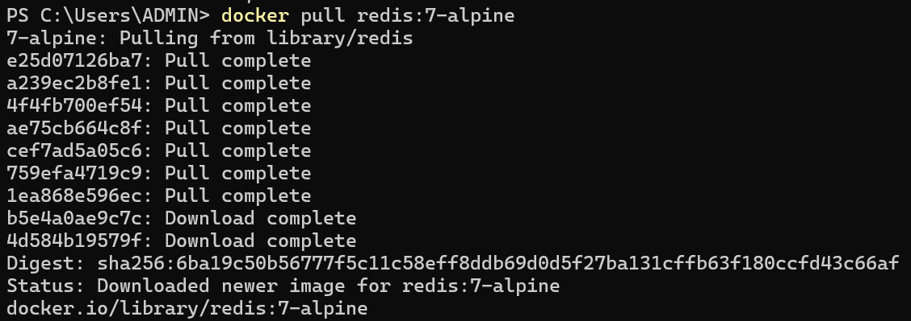

**2. Chạy Redis container**

```bash
docker run -d --name redis -p 6379:6379 redis:7-alpine
```

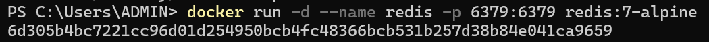

**3. Kiểm tra Redis đang chạy**

```bash
docker ps
```

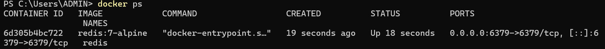

**4. Mở Redis CLI**

```bash
docker exec -it redis redis-cli
```

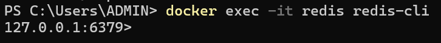

**5. Thử một vài câu lệnh**

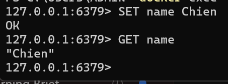

**6. Test EXPIRE và TTL**

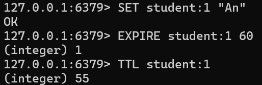

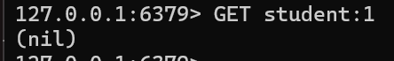

## 4. Implement — Tích hợp Redis vào project

**1. Tạo mới dữ liệu**

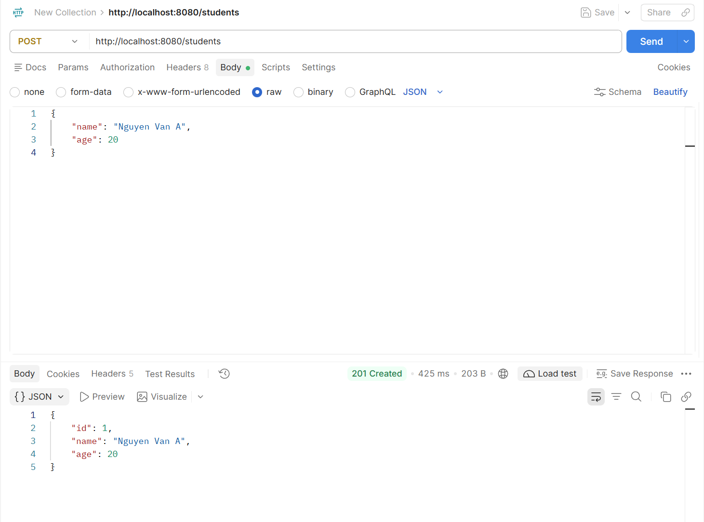

**2. Kiểm tra dữ liệu có trong cache hay chưa**

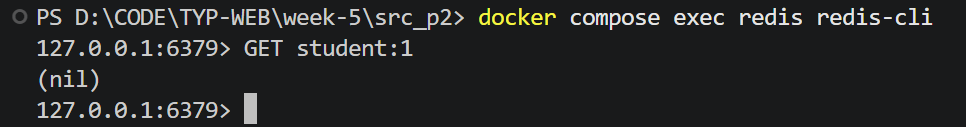

**3. Lấy dữ liệu lần 1 - Cache Miss**

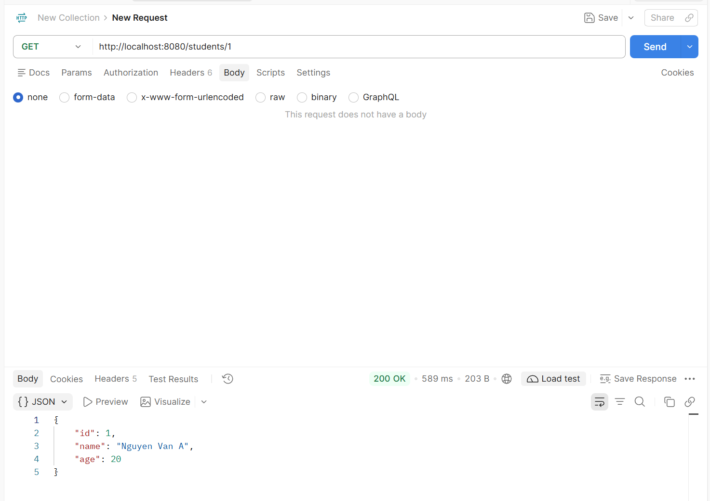

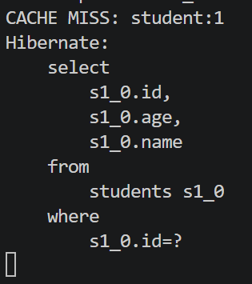

**4. Dữ liệu đã có trong cache**

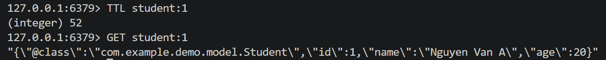

**5. Lấy dữ liệu lần 2 - Cache Hit**

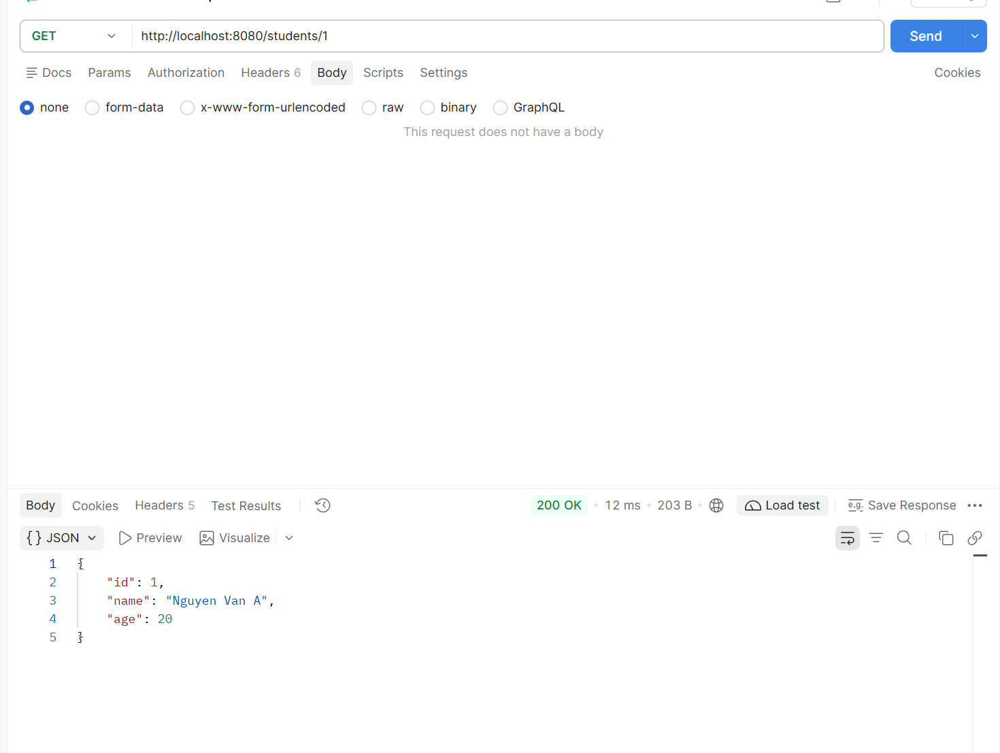

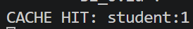

**6. So sánh reponse time**

```text
Lần 1:
CACHE MISS
Response time: 589 ms

Lần 2:
CACHE HIT
Response time: 12 ms
```

## 5. Các vấn đề thường gặp

### 5.1. TTL: đặt bao lâu là hợp lý?

**TTL (Time To Live)** là thời gian một key được phép tồn tại trong cache trước khi Redis tự xóa nó.

*Ví dụ:* `SET student:1 "..." EX 60`

*Nghĩa là student:1 tồn tại trong 60 giây*

*Sau 60 giây: `GET student:1` sẽ trả (nil)*

**Vấn đề là:** TTL không có một giá trị đúng cho mọi loại dữ liệu.

*Nếu TTL quá ngắn: `TTL = 5 giây`. Thì cache liên tục hết hạn.*

Khi đó **lợi ích của cache giảm đi** vì database vẫn bị query nhiều.

**Ngược lại**, nếu TTL quá dài: `TTL = 24 giờ`. Thì dữ liệu có thể bị cũ.

*Ví dụ:*

```text
Redis:
student:1 age = 20
```

*Nhưng database đã update:* `student:1 age = 21`

*Nếu cache chưa được invalidation thì client vẫn có thể nhận:* `age = 20`

**Do đó,** TTL thường được chọn theo mức độ thay đổi của dữ liệu.

*Ví dụ:*

| Dữ liệu | TTL có thể dùng |
|:--:|:--:|
| Dữ liệu thay đổi thường xuyên | vài giây – vài phút |
| Student/User profile | vài phút |
| Product information | vài phút – hàng chục phút |
| Configuration ít thay đổi | hàng giờ |
| Dữ liệu gần như cố định | TTL dài hơn |

### 5.2. Cache Invalidation: khi data thay đổi thì xóa/update cache thế nào?

Đây là một trong những **vấn đề quan trọng nhất** của caching.

*Giả sử Redis đang có:*

```text
student:1
{
    name: "Nguyen Van A",
    age: 20
}
```

*Database cũng có:* `age = 20`

*Sau đó gọi: `PUT /students/1` để đổi `age = 21`*

*Database trở thành: `age = 21` nhưng Redis vẫn giữ `age = 20`

*Khi gọi `GET /students/1` Redis trả dữ liệu cũ.*

Đây là **Stale Cache**. Do đó, khi dữ liệu thay đổi phải xử lý cache.

#### 5.2.1. Update cache

Sau khi update database, thì cập nhật luôn Redis.

```text
 PUT Student
     ↓
 Update DB
     ↓
Update Redis
```

Nhưng phải đảm bảo DB và Redis luôn đồng bộ.

#### 5.2.2. Xóa cache

Sau khi update database, thì xóa Cache cũ.

```text
 PUT Student
     ↓
 Update DB
     ↓
DEL student:1
```

### 5.3. Cache Avalanche: nhiều key hết hạn cùng lúc → DB bị overload

**Cache Avalanche** xảy ra khi rất nhiều key hết hạn gần như cùng lúc.

*Ví dụ Redis đang cache:*

```text
product:1     TTL = 60
product:2     TTL = 60
product:3     TTL = 60
...
product:10000 TTL = 60
```

*Tất cả được tạo cùng lúc. Sau đúng 60 giây:*

```text
product:1     expired
product:2     expired
product:3     expired
...
product:10000 expired
```

*Nếu ngay lúc đó có rất nhiều request. Thì tất cả đều MISS và phải trỏ thẳng xuống Database.*

*Database đột nhiên nhận **hàng nghìn hoặc hàng triệu request**.*

*Có thể dẫn tới:*

- Database quá tải
- Reponse chậm
- Timeout
- Service lỗi

**Một cách phổ biến là thêm thời gian ngẫu nhiên vào TTL.**

*Thay vì: Mọi key TTL = 60 giây*

*Dùng:*

```text
product:1 → 63 giây
product:2 → 71 giây
product:3 → 66 giây
product:4 → 79 giây
```

*Ví dụ: `long ttl = 60 + random.nextInt(30);` thì TTL nằm khoảng: 60 → 89 giây*

*Các key sẽ hết hạn rải rác thay vì cùng lúc*

**Ngoài ra hệ thống lớn có thể dùng:**

- Rate limiting
- Fallback
- Multi-level cache
- Pre-warming cache

### 5.4. Cache Penetration: query data không tồn tại → luôn miss cache → query DB liên tục

**Cache Penetration** xảy ra khi client liên tục request một dữ liệu *không tồn tại trong database*.

*Ví dụ:* `GET /students/999999`

*Redis:* `student:999999 → không có`

*Cache miss:* `Redis MISS → Database`

*Database cũng không có*

*Application trả: `404 Not Found`*

*Nhưng vì không có Student nên bạn không cache gì.*

Nếu có **hàng nghìn request** cố tình gửi như vậy, thì *Redis gần như vô dụng*. Mọi request đều xuyên qua cache vào Database.

**Cách xử lý: Cache Null**

Nếu *database không tìm thấy*, ta vẫn cache kết quả *“không tồn tại”* trong thời gian ngắn.

*Ví dụ:*

```text
student:999999 → NULL
TTL = 30 giây
```

*Request tiếp theo: Không cần query database nữa.* 

```text
GET /students/999999
          ↓
        Redis
          ↓
đã biết không tồn tại
          ↓
         404
```

